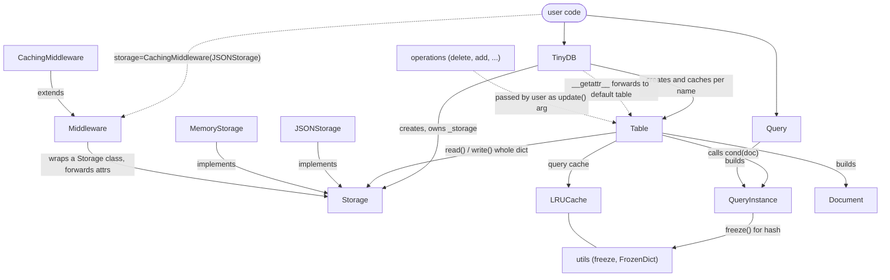

# TinyDB Architecture (v4.9.0, commit edff96a)

## 1. Overview

TinyDB is a small document database written in pure Python. The whole database is one nested `dict` (`{table_name: {doc_id: document}}`, see `tinydb/database.py:52-66`) that a *storage* reads and writes in full. Everything else is layered on top of that read-whole / write-whole contract. The package has seven modules, grouped here into six components.

| Component | File | Role |
|---|---|---|
| **TinyDB** | `database.py` | Entry point. Instantiates the storage (`database.py:95`), keeps a `dict` of `Table` objects by name (`:98`, `:111-133`), and forwards unknown attributes and `len`/`iter` to the default table `_default` (`:251-274`). Also a context manager (`:232-249`). |
| **Table** (+ `Document`) | `table.py` | CRUD on one table: insert, search, get, update, upsert, remove. Every operation is read-whole-storage, modify, write-whole-storage (`_read_table`, `_update_table`, `table.py:779-854`). Owns a per-table query cache and the doc-ID counter. `Document` is a `dict` subclass with a `doc_id` attribute (`:22-32`). |
| **Query** (`queries.py`) | `queries.py` | `Query`/`where` is a builder that produces `QueryInstance` callables (`Mapping -> bool`). Each instance carries a hashable `_hash` (or `None` = not cacheable) so it can key the query cache. Also defines the `QueryLike` Protocol (`:35-56`). |
| **Storage** (`storages.py`) | `storages.py` | Abstract `Storage` with `read()`/`write()`/`close()`; `JSONStorage` (file) and `MemoryStorage` (in-memory). `read()` returns `None` for "empty". |
| **Middleware** (`middlewares.py`) | `middlewares.py` | `Middleware` wraps a storage *class* and is itself callable, so it can be passed as `storage=`; unknown attributes are forwarded to the wrapped storage. `CachingMiddleware` buffers writes and serves reads from memory. |
| **utils / operations** | `utils.py`, `operations.py` | `utils`: `LRUCache`, `FrozenDict`, `freeze`, `with_typehint`. `operations`: update-transform helpers (`delete`, `add`, ...) passed to `Table.update`. `mypy_plugin.py` only supports typing and is not imported at runtime. |

**Who calls whom (verified imports).**
- `database` imports `storages` (via package `__init__`), `table`, `utils` (`database.py:7-10`).
- `table` imports `queries` (only for the `QueryLike` type), `storages` (type only) and `utils.LRUCache` (`table.py:15-17`). It does **not** import `operations`; operations are plain callables passed in by the user.
- `queries` imports only `utils.freeze` (`queries.py:23`).
- `storages` and `operations` import nothing from the package. `utils` imports nothing from the package.
- `middlewares` imports `Storage` from the top-level `tinydb` package (`middlewares.py:7`) and is not imported by anything in the package; users compose it.
- `tinydb/__init__.py` imports `queries`, `storages`, then `database` (`:28-31`); that order matters (see Constraint 1).

Typical flow for `db.search(where('a') == 1)`: `TinyDB.__getattr__` resolves to `Table.search`; the table checks `_query_cache` keyed by the query's hash; on a miss it calls `storage.read()`, applies the query to each raw document, wraps matches in `Document`, and caches the list if the query `is_cacheable()` (`table.py:262-296`). Any write ends with `storage.write(...)` and `clear_cache()` (`table.py:849-854`).

## 2. Architecture Decision Records

### ADR-1: Storage interface is "read the whole database / write the whole database"

**Context.** TinyDB wants to be tiny and let users plug in any backend (JSON, YAML, memory, wrappers). Per-record backend APIs would make every backend much larger.

**Decision.** `Storage` has only `read() -> dict | None`, `write(dict)` and an optional `close()` (`storages.py:36-76`). `Table._update_table` reads everything, runs an updater on one table, and writes everything back; its docstring states the interface "only allows to read/write the complete database data" (`table.py:804-815`). `None` from `read()` means an uninitialised store (`storages.py:54`, `database.py:157-161`).

**Alternatives considered.** (a) Per-document/per-table storage methods (get, put, delete by ID); (b) a query-pushdown interface so the storage could filter. Both rejected implicitly by the interface shape.

**Consequences.** Custom storages are trivial to write, and `Middleware`/`CachingMiddleware` can wrap any storage transparently. Cost: every write is O(database size); there is no partial update or concurrency control.

Status: **Verified** (code comment at `tinydb/table.py:806-809`; the changelog also records that "Empty storages are now expected to return `None` instead of raising `ValueError`", `docs/changelog.rst:488`).

### ADR-2: Middleware as a callable wrapper around a storage *class*

**Context.** Cross-cutting behaviour (caching, etc.) should compose with any storage without changing `TinyDB`, which just does `storage(*args, **kwargs)` (`database.py:92-95`).

**Decision.** `Middleware.__init__` stores the storage *class*; `__call__` instantiates it with the forwarded args and returns `self` (`middlewares.py:21-65`); `__getattr__` forwards everything else to the wrapped storage (`:67-73`). Because a `Middleware` instance is callable like a class, middlewares nest and `TinyDB` needs no special handling.

**Alternatives considered.** Subclassing storages per feature; TinyDB accepting a list of middlewares; wrapping an already-built storage instance.

**Consequences.** `TinyDB` is oblivious to middleware, but the user passes a half-configured object (`TinyDB(path, storage=CachingMiddleware(JSONStorage))`). Subclasses must call `super().__init__` (`middlewares.py:17-18`). Middleware must itself honour the `Storage` contract (`read`/`write`/`close`); `CachingMiddleware` keeps `_closed` and raises `ValueError` after close (`:97-99`, `:108-110`, fixed in commit `18d73a1`, "reject CachingMiddleware reads and writes after close (#634)").

Status: **Inferred** for the "why" (design alternatives are my reasoning; the code documents the mechanism at `middlewares.py:25-61` but not the rejected options). The existence of the mechanism and the #634 fix are verified.

### ADR-3: Query objects carry a stable hash; results are cached per table in an LRU cache

**Context.** Repeated `search()` calls would otherwise re-read and re-scan the whole table each time.

**Decision.** `QueryInstance` holds `_hash` (a tuple built from the operator, path and `freeze()`-ed arguments; `None` means "not cacheable", `queries.py:59-88`, `:264`). `Table` keeps `_query_cache = LRUCache(capacity=cache_size)` (default capacity 10, `table.py:92`, `:107-108`), stores results only if `is_cacheable()` (`table.py:291-295`), and discards the whole cache after every write (`table.py:853-854`). `cache_size=0`/small values tune or disable it (changelog: "Allow disabling the query cache with `db.table(name, cache_size=0)`", `docs/changelog.rst:345`).

**Alternatives considered.** No caching; per-document invalidation (moved out to the external `tinydb-smartcache`, whose `SmartCacheTable` "has been moved", `docs/changelog.rst:486`); caching keyed by closures (not hashable, hence `freeze`/`FrozenDict`).

**Consequences.** Fast repeated reads; correct invalidation is trivial because any write clears everything. Costs: queries must be hashable or silently become uncacheable (`queries.py:80-85`); cached lists are fresh copies but share `Document` objects with the cache (`table.py:254-256`, `:267`), so mutating a result can corrupt later cached results.

Status: **Verified** (commit `c5d6863` "feat(table): make default cache capacity configurable"; commit `19066e0` "fix LRUCache treating stored None values as missing (#635)"; commit `e83efcd` "include regex flags in matches/search query hash (#640)", showing that hash correctness is load-bearing; changelog lines cited above).

## 3. Constraints

1. **Keep the import order in `__init__.py` and the one-way dependency direction.** `database.py:7` does `from . import JSONStorage`, which only works because `__init__.py` imports `storages` (`:29`) before `database` (`:30`). `table`, `queries`, `storages`, `utils` and `operations` must never import `database`, and `utils`/`storages`/`operations` must not import any other package module (see imports in `table.py:15-17`, `queries.py:23`, `utils.py:5-7`, `storages.py:6-11`, `operations.py:12-13`). `middlewares.py:7` imports from the package root, so nothing in the core may import `middlewares`.
2. **All persistence goes through `Storage.read()`/`write()` of the full dict; `read()` may return `None`.** `Table` must treat `None` as empty (`table.py:791`, `:820`; `database.py:161`, `:191`) and every mutation must go through `_update_table` (`table.py:804-854`). Do not write directly to a storage from `Table` outside it, and note the exception that `TinyDB.drop_tables`/`drop_table` write to the storage directly (`database.py:170`, `:202`) and so must also clear/forget `_tables` entries (`:174`, `:185-186`).
3. **Every write path must invalidate the query cache.** `_update_table` ends with `self.clear_cache()` (`table.py:854`) and `truncate` clears it via `_update_table` (`:704`). Any new code that mutates storage without `_update_table` must call `clear_cache()` itself.
4. **Queries used as cache keys need a stable, hashable `_hash`; unhashable arguments must be `freeze()`-d, and anything that cannot be hashed must degrade to non-cacheable (`None`), never raise.** See `queries.py:59-88` (fallback to `None`), `:264`, `:405`, `:440` (`freeze(...)` of arguments), and `Table.search` honouring `is_cacheable()` (`table.py:291-295`). Include every parameter that changes semantics in the hash (cf. commit `e83efcd`, regex flags).
5. **JSON-backed storages stringify doc IDs, so `Table` converts IDs both ways and never trusts the storage's key type.** `_update_table` maps keys to `document_id_class` on the way in (`table.py:833-837`) and back to `str` on the way out (`:844-848`); readers re-wrap with `document_id_class(doc_id)` (`table.py:273`, `:381`, `:742`). IDs must be monotonically assigned via `_get_next_id` (`:744-776`), with `_next_id` reset when the table is truncated (`:707`).
